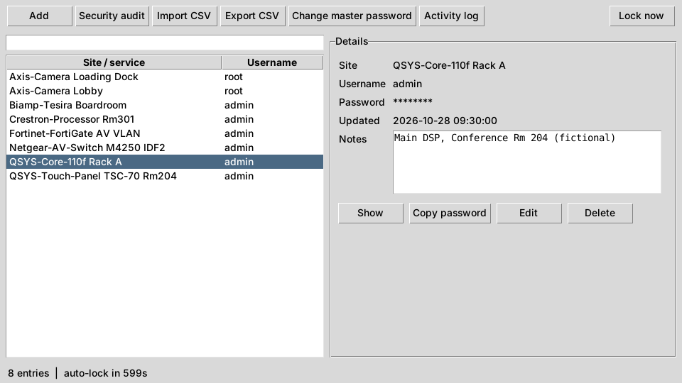
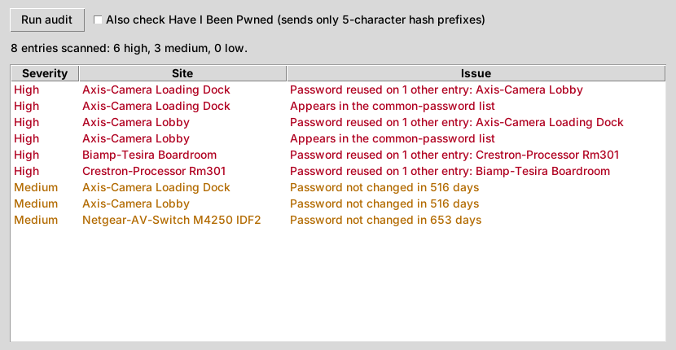
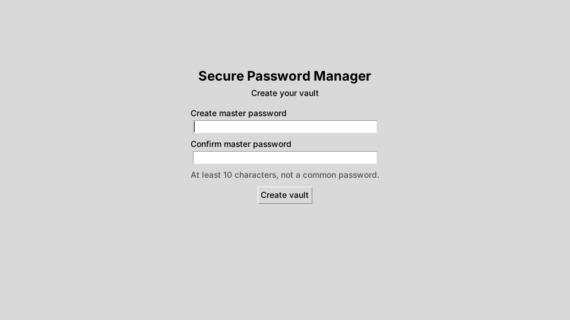
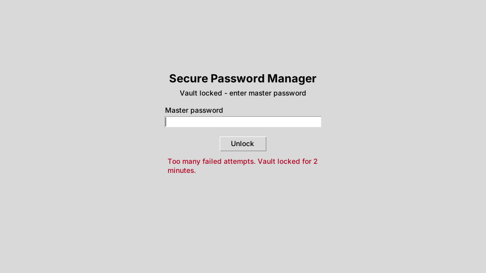
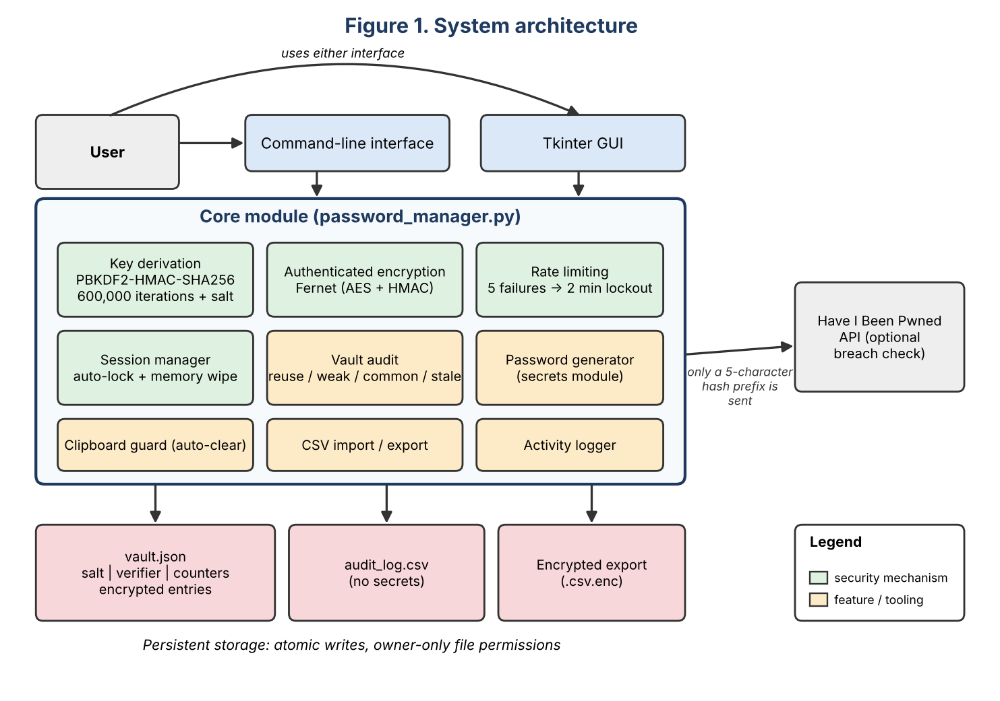

# Secure Password Manager

A password manager built in Python for the **CIS 4365 individual security project**. It stores credentials in an
encrypted vault protected by one master password, and adds defenses against the most common ways a vault gets
exposed: password guessing, stolen files, unattended sessions, shoulder-surfing and tampering. It also audits the
vault for weak, reused and breached passwords, and includes sample data modeled on AV/IT equipment logins.

Author: *your name here* | Course: CIS 4365 | Language: Python 3.9+ (tested on 3.12)

> **Educational project.** It has not had an independent security review. Don't use it for your real passwords.

## Screenshots

| Main window | Security audit |
|---|---|
|  |  |

| Create vault | Lockout after failed attempts |
|---|---|
|  |  |

More: [add entry + generator](docs/screenshots/03_add_entry_generator.png), [activity log](docs/screenshots/06_activity_log.png).

## Features

**Core security**
- Master password never stored. A key is derived with **PBKDF2-HMAC-SHA256** (600,000 iterations, random 16-byte salt; the count is stored per vault so it can be raised later).
- Vault encrypted with **Fernet** (AES + HMAC authentication), so tampering is detected and refused.
- **Lockout:** 5 wrong master passwords trigger a 2-minute lockout.
- **Auto-lock:** the vault locks itself after inactivity (default 90 s) and drops decrypted data from memory.
- Passwords generated with Python's `secrets` module (cryptographically secure).

**Risk detection**
- **Vault audit:** flags reused, common, weak and stale (>90 days) passwords, rated High / Medium / Low.
- **Breach check (optional):** Have I Been Pwned lookup using *k-anonymity*: only the first 5 characters of the
  password's SHA-1 hash are sent, so the password itself never leaves your computer.

**Safe data handling**
- CSV **import/export**. Export is encrypted by default and requires re-entering the master password; plaintext is
  available with a warning. Import accepts common header names and handles duplicates (skip / overwrite / keep both).
- **Change master password:** new salt, whole vault re-encrypted.
- **Atomic saves** (a crash can't corrupt the vault) and owner-only file permissions.
- **Clipboard auto-clear** after 20 seconds.
- **Activity log** (`audit_log.csv`) of unlocks, failures, lockouts, exports and audits. It never contains secrets.

## Requirements

- Python 3.9 or newer
- `pip install -r requirements.txt`
- GUI only: Tkinter (included with Python on Windows/macOS; on Debian/Ubuntu run `sudo apt install python3-tk`)

## Run it

```bash
pip install -r requirements.txt

python3 password_manager.py          # command-line version
python3 password_manager_gui.py      # graphical version
```

The first run asks you to create a master password (at least 10 characters, not a common password). Both versions
use the same `vault.json` in the current folder. Options:

```bash
--vault PATH       use a different vault file
--timeout SECONDS  change the inactivity auto-lock time (handy for demos)
```

**There is no password recovery.** The master password is never stored, so a forgotten one cannot be reset.

## Try it with the sample data

`sample_data/av_demo_credentials.csv` contains **fictional** AV-style logins (DSPs, touch panels, cameras, a switch,
a firewall) with deliberate problems: two cameras share a weak default password, two DSP/processor logins reuse the
same password, and two entries are very old.

1. Run the GUI with a throwaway vault: `python3 password_manager_gui.py --vault demo_vault.json`
2. Create a master password, then click **Import CSV** and choose the sample file.
3. Click **Security audit** and run it. It should flag the reuse, the common password and the stale entries.

## Tests

```bash
python3 test_password_manager.py -v     # 38 unit tests
python3 test_gui.py                      # 36 GUI checks (needs a display; see below)
python3 benchmark_kdf.py                 # key-derivation timing
```

Headless Linux: `xvfb-run -a python3 test_gui.py`. The unit tests cover encryption round-trips, lockout and expiry,
tamper detection, old-format vaults still opening and being upgraded, CSV edge cases, the breach check sending only the 5-character
prefix, secrets never appearing in logs, and the session and clipboard timers.

## How it is built

```
password_manager.py      core logic + command-line interface
password_manager_gui.py  Tkinter interface (uses the core module)
test_password_manager.py unit tests
test_gui.py              GUI integration test
benchmark_kdf.py         PBKDF2 timing benchmark
sample_data/             fictional AV credentials for demos
docs/                    architecture diagrams, screenshots, demo notes
```



| Threat | Defense |
|---|---|
| Stolen `vault.json` | Authenticated encryption; slow key derivation makes each guess expensive |
| Online password guessing | Failed-attempt counter and 2-minute lockout |
| Unattended unlocked session | Inactivity auto-lock that clears decrypted data |
| Shoulder-surfing / clipboard sniffing | Masked passwords; clipboard auto-clear |
| Tampering or corruption | HMAC check refuses modified vaults; atomic saves prevent half-written files |
| Weak or reused passwords | Vault audit; breach check using k-anonymity |
| Leaking secrets through logs/exports | Log never records secrets; encrypted export by default; re-authentication |

## Known limitations

- The lockout counter is stored in the vault file, so it slows guessing through this program but cannot stop an
  attacker who copies the file and guesses offline. A strong master password is the real protection there.
- Python can't guarantee memory is zeroed; "wiping" drops references and is best-effort.
- Vaults created by earlier versions of this project (480,000 iterations) still open; changing the master password
  upgrades them. Newer vaults cannot be opened by those earlier versions.
- Encrypted exports can't be read after the master password changes (the key changes).
- The activity log is not tamper-evident.

## Demo

See [docs/DEMO_NOTES.md](docs/DEMO_NOTES.md) for the demo walkthrough used for the project presentation.
